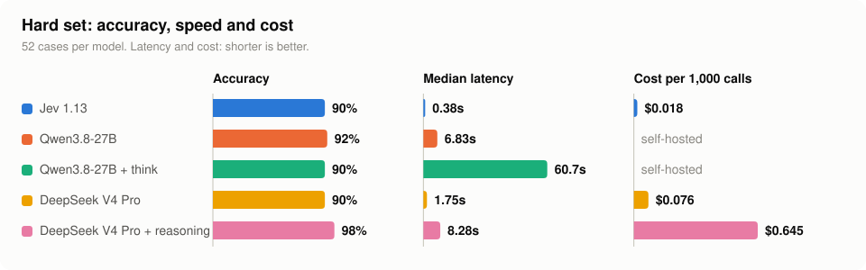
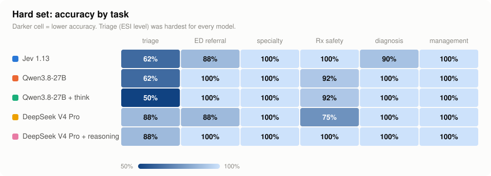
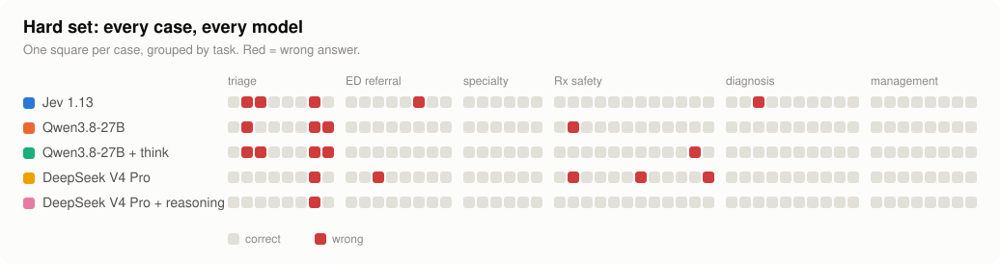
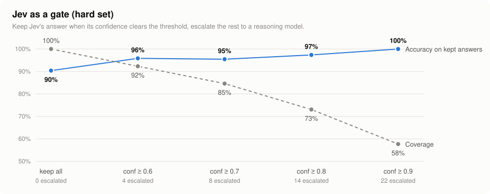
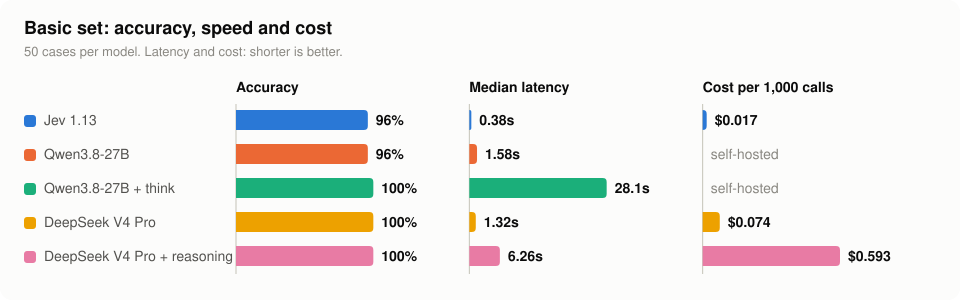
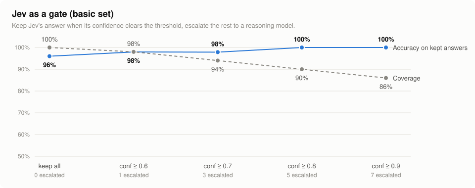

# Jev medical decision benchmark

A small benchmark comparing a **decision model** (Jev by TypeSafe AI, which returns a typed choice, score or yes/no probability instead of generating text) with general chat LLMs on medical decision tasks.

The question it tests: a decision model is fast and cheap because it never writes out its reasoning. Does that cost accuracy on clinical judgment, especially when the decisive detail is buried in the case?

Any model can be plugged in through `config.json` as an API endpoint: a Jev-style decisions endpoint, or any OpenAI-compatible `/chat/completions` endpoint.

## Tasks

Each task maps to one of Jev's three question types. The chat LLMs get the same question and the same allowed answers, and must reply with one key.

| Task | Type | Question |
|---|---|---|
| triage | score | Emergency Severity Index (ESI) level, 1 to 5 |
| ed_referral | yes/no | Does this patient need the emergency department today? |
| specialty | choice | Which specialist clinic? |
| rx_safety | yes/no | Is this prescription unsafe for this patient? |
| diagnosis | choice | Most likely diagnosis, A to D |
| management | choice | Most appropriate next step, A to D (hard set only) |

## Datasets

- `data/basic.json`: 50 cases, 10 per task, half easy and half hard. Hard cases hide the key fact inside a reassuring story (for example a patient on warfarin who "just bumped her head", or SpO2 89% in someone asking for a sick note).
- `data/hard.json`: 52 complex cases. Buried danger (a calm patient after a paracetamol overdose), dose checks that need a creatinine clearance calculation, acid-base reasoning, "looks dangerous but is safe" traps, and a management task.

All cases are synthetic and were written for this benchmark. The gold answers follow standard guidance (ESI handbook, common prescribing references) but **have not been reviewed by an independent clinician**. Please open an issue if you disagree with one.

## Results

Models tested on 2026-09-27:

| Label | Model |
|---|---|
| Jev 1.13 | TypeSafe Jev 1.13 |
| Qwen3.8-27B | Qwen3.8-27B, 4-bit (AWQ INT4), self-hosted with vLLM on a single NVIDIA RTX 4090, answer only |
| Qwen3.8-27B + think | Same, thinking enabled |
| DeepSeek V4 Pro | Hosted, reasoning off |
| DeepSeek V4 Pro + reasoning | Hosted, reasoning on |

### Hard set (52 complex cases)

<picture>
  <source media="(prefers-color-scheme: dark)" srcset="docs/charts/hard_overview_dark.svg">
  
</picture>

| Model | Accuracy | p50 latency | p95 | Avg output tokens | Cost / 1000 calls |
|---|---|---|---|---|---|
| DeepSeek V4 Pro + reasoning | **98%** | 8.28s | 23.38s | 542 (449 reasoning) | $0.645 |
| Qwen3.8-27B | 92% | 6.83s | 11.07s | 8 | $0 (own RTX 4090) |
| Jev 1.13 | 90% | **0.38s** | 3.32s | 38 | **$0.018** |
| DeepSeek V4 Pro | 90% | 1.75s | 4.72s | 7 | $0.076 |
| Qwen3.8-27B + think | 90% | 60.74s | 113.03s | 656 | $0 (own RTX 4090) |

Accuracy by task:

<picture>
  <source media="(prefers-color-scheme: dark)" srcset="docs/charts/hard_tasks_dark.svg">
  
</picture>

| Model | triage | ed_referral | specialty | rx_safety | diagnosis | management |
|---|---|---|---|---|---|---|
| Jev 1.13 | 62% | 88% | 100% | 100% | 90% | 100% |
| Qwen3.8-27B | 62% | 100% | 100% | 92% | 100% | 100% |
| Qwen3.8-27B + think | 50% | 100% | 100% | 92% | 100% | 100% |
| DeepSeek V4 Pro | 88% | 88% | 100% | 75% | 100% | 100% |
| DeepSeek V4 Pro + reasoning | 88% | 100% | 100% | 100% | 100% | 100% |

<picture>
  <source media="(prefers-color-scheme: dark)" srcset="docs/charts/hard_cases_dark.svg">
  
</picture>

Jev as a gate (keep confident answers, escalate the rest to a reasoning model):

| Confidence | Coverage | Accuracy on kept | Escalated |
|---|---|---|---|
| >= 0.6 | 92% | 96% | 4 |
| >= 0.8 | 73% | 97% | 14 |
| >= 0.9 | 58% | 100% | 22 |

<picture>
  <source media="(prefers-color-scheme: dark)" srcset="docs/charts/hard_gate_dark.svg">
  
</picture>

### Basic set (50 cases)

<picture>
  <source media="(prefers-color-scheme: dark)" srcset="docs/charts/basic_overview_dark.svg">
  
</picture>

| Model | Accuracy | p50 latency | Cost / 1000 calls |
|---|---|---|---|
| Jev 1.13 | 96% | 0.38s | $0.017 |
| Qwen3.8-27B | 96% | 1.58s | $0 (own RTX 4090) |
| Qwen3.8-27B + think | 100% | 28.14s | $0 (own RTX 4090) |
| DeepSeek V4 Pro | 100% | 1.32s | $0.074 |
| DeepSeek V4 Pro + reasoning | 100% | 6.26s | $0.593 |

On the basic set, Jev at confidence >= 0.8 covered 90% of cases at 100% accuracy.

<picture>
  <source media="(prefers-color-scheme: dark)" srcset="docs/charts/basic_gate_dark.svg">
  
</picture>

Full tables and every model output: `results/`.

### What we take from it

1. **Reasoning helped the large model, not the small one.** DeepSeek V4 Pro went from 90% to 98% with reasoning on. Qwen3.8-27B did not improve with thinking (92% to 90%) and was about 9 times slower.
2. **Jev matched the non-reasoning LLMs** (90% vs 90 to 92%) at a fraction of the latency and cost: 22 times faster and 37 times cheaper than DeepSeek with reasoning.
3. **Jev's misses were the dangerous kind.** It labelled a ruptured aortic aneurysm as renal colic, and under-triaged a silent-chest asthma attack and a calm paracetamol overdose.
4. **Non-reasoning DeepSeek was over-cautious on prescriptions**, flagging three safe prescriptions as unsafe. Reasoning fixed all three.
5. **Jev works as a gate.** At confidence >= 0.9 it was right on every case it kept, but escalated 42% of the hard set.

In short: a decision model is a cheap, fast filter for routine calls, not a replacement for a reasoning model on complex clinical judgment.

### Caveats

- Small sets: one case is about 2 percentage points.
- Case `h_t07` (wrist injury, gold ESI 4) was answered ESI 3 by every model; the gold label is probably the one at fault.
- Latency was measured with 4 concurrent requests per model. Qwen latency is for 27B 4-bit on one RTX 4090 serving 4 requests at once, and will differ on other hardware.
- Cost is the provider-reported cost per call.

## Setup

Python 3.10+.

```
pip install -r requirements.txt
cp config.example.json config.json
```

Edit `config.json` with your own endpoints and models, then set the API key environment variables it names.

### config.json fields

| Field | Used by | Meaning |
|---|---|---|
| `key` | all | Short id, used with `--models` |
| `name` | all | Label in the result tables |
| `type` | all | `decision` or `chat` |
| `url` | decision | Full URL of the decisions endpoint |
| `base_url` | chat | OpenAI-compatible base URL, e.g. `https://your-endpoint/v1` |
| `model` | all | Model id the endpoint expects |
| `api_key_env` | optional | Name of the environment variable that holds the API key. Keys never go in the file. Omit if the endpoint needs no key. |
| `think` | chat | `true` asks the model to reason step by step and end with `ANSWER: <key>`; `false` asks for JSON only |
| `max_tokens` | chat | Output cap (default 200, or 8000 with `think`) |
| `extra_body` | chat | Extra JSON merged into the request, e.g. your endpoint's switch for turning reasoning on or off |
| `price_in`, `price_out` | optional | USD per 1M tokens, used for cost when the endpoint does not report it. Use 0 for self-hosted models. |
| `proxy` | optional | e.g. `socks5://localhost:1080` |
| `timeout` | optional | Seconds per request (default 600) |

Keys are read from environment variables, for example:

```
export JEV_API_KEY=...  LLM_API_KEY=...        # macOS / Linux
$env:JEV_API_KEY="..."; $env:LLM_API_KEY="..."  # Windows PowerShell
```

Add as many `chat` entries as you want to compare; each needs a unique `key`.

### Decision endpoint format

The example config points at TypeSafe's official API, `POST https://api.typesafe.ai/v1/systemone` with model `jev-latest` (see the [API reference](https://docs.typesafe.ai/api)). Its response reports tokens but not cost, so set `price_in` / `price_out` from TypeSafe's current pricing if you want cost in the tables.

The `decision` type sends:

```json
{"model": "<model>",
 "state": {"case": "<case text>"},
 "questions": {"q": {"type": "choice", "instructions": "...", "criteria": {"A": "...", "B": "..."}}}}
```

and reads `answers.q` (`noul` probability, `choice` + `confidence`, or `score` + `probabilities`) and `usage` from the response. If your provider's schema differs, adapt `call_decision()` in the script.

## Run

```
python jev_medical_bench.py                         # basic set, every model in config.json
python jev_medical_bench.py --dataset hard          # complex set
python jev_medical_bench.py --models jev,llm        # only some models
python jev_medical_bench.py --limit 5               # smoke test
python jev_medical_bench.py --dataset my_cases.json # your own cases
```

Options: `--workers N` (default 4), `--config path`.

Each run prints the tables and saves `results/<time>_<dataset>/summary.md` and `details.csv` (one row per model per case: prediction, confidence, latency, tokens, cost, raw output).

## Case format

```json
{"id": "d01", "task": "diagnosis", "level": "hard", "gold": "C",
 "text": "Case vignette ...",
 "options": {"A": "...", "B": "...", "C": "...", "D": "..."}}
```

- `triage`: `gold` is the ESI level 1 to 5. In the tables it shows as a score index, where 0 means ESI 5 and 4 means ESI 1.
- `ed_referral`, `rx_safety`: `gold` is `"true"` or `"false"`.
- `specialty`: `gold` is one of the clinic keys in the script.
- `diagnosis`, `management`: per-case `options`; `gold` is the option key.

## Disclaimer

Research and evaluation only. Not medical advice and not for clinical use.
